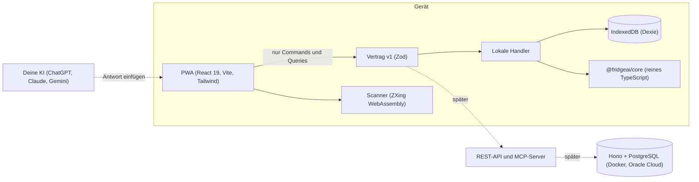

# FridgeAI 🥬

[](https://github.com/BanioX/FridgeAI/actions/workflows/ci.yml)

> **Scan deinen Bon – FridgeAI weiss, was du hast, wem es gehört, wer was schuldet und was du heute retten musst.**

Local-first PWA für Schweizer Haushalte (WGs, Paare, Familien) gegen Food Waste. Alles funktioniert offline auf dem Gerät; KI-Erkennung läuft über die KI, die du ohnehin nutzt (ChatGPT, Claude, Gemini), ohne Kosten für FridgeAI.

**Product Owner:** Alban Hyseni · **Status:** bereit für den Pilot ([`docs/pilot.md`](docs/pilot.md)); Bon-Scan und Teilen im Haushalt folgen · **Lizenz:** proprietär, alle Rechte vorbehalten

---

## Inhalt

- [Was die App heute kann](#was-die-app-heute-kann)
- [Am Handy ausprobieren](#am-handy-ausprobieren)
- [Am Rechner entwickeln](#am-rechner-entwickeln)
- [Architektur](#architektur)
- [Projektstruktur](#projektstruktur)
- [Arbeitsweise](#arbeitsweise)
- [Datenschutz und Sicherheit](#datenschutz-und-sicherheit)
- [Dokumentation](#dokumentation)
- [Lizenz](#lizenz)

## Was die App heute kann

| Bereich | Funktion |
| --- | --- |
| **Heute retten** | Was bald abläuft, Wert im Kühlschrank in CHF, Lagerorte auf einen Blick |
| **Vorrat** | Kühlschrank, Tiefkühler, Vorrat, Notvorrat (bis 100 Jahre) |
| **Erfassen** | Name genügt: Kategorie, Lagerort, Menge, Verpackung und Ablaufdatum werden vorgeschlagen; Eier im 6er/10er, Datumsfeld mit Schnellwahl und Eintippen; «Schnell erfassen»: die eigenen Standardartikel mit einem Tipp |
| **Scannen** | Barcode, QR und GS1-DataMatrix (Datum aus dem Code); KI-Import: Foto in deiner KI, Liste in FridgeAI übernehmen |
| **Abschliessen** | Gegessen, weitergegeben (an wen), weggeworfen (warum) – ganz oder in sinnvollen Portionen (⅛ Kuchen, ⅓ Käse, 2 von 4 Joghurts) |
| **Öffnungsregel** | «Nach dem Öffnen innert 21 Tagen» verkürzt das Datum automatisch |
| **Einfrieren** | Umlagern mit neu geschätztem Datum |
| **Kühlschrank-Check** | Einmal pro Woche jeden Artikel kurz bestätigen: noch da, halb, gegessen oder weggeworfen |
| **Korrigieren** | Rückgängig nach Gegessen/Weggeworfen; Name, Kategorie, Ort, Datum, Menge und Preis ändern; Artikel löschen |
| **Produktdaten** | Nach dem Scan: Bild, Marke, Nährwerte, Nutri-Score, Allergene (Open Food Facts, 30 Tage offline) |
| **Rezeptideen** | Bis zu drei Rezepte, die retten, was bald abläuft; was fehlt, mit einem Tipp auf die Einkaufsliste; nach dem Kochen abbuchen |
| **Einkaufsliste** | «Du hast noch …» gegen Doppelkäufe, abhaken, «In den Vorrat legen» |
| **Wirkung** | Gerettet und weggeworfen diesen Monat in CHF und Gewicht |
| **Haushalt** | App installieren, alles exportieren (JSON/CSV) oder löschen, Datenschutz in Kürze |

Geplant: Teilen in WG und Familie, Kosten aufteilen, Push-Erinnerungen, Wirkungs-Dashboard, MCP-Connector für ChatGPT/Claude, Büro-Kühlschrank. Reihenfolge: [`docs/plan.md`](docs/plan.md).

## Am Handy ausprobieren

Jeder Pull Request bekommt automatisch einen eigenen **Vorschau-Link** (Cloudflare schreibt ihn als Kommentar in den PR). `main` läuft unter der festen Produktionsadresse. Einrichtung und Tipps: [`docs/previews.md`](docs/previews.md).

1. Link öffnen (iPhone: Teilen → «Zum Home-Bildschirm» für App-Gefühl).
2. **«Beispieldaten laden»** auf der Startseite tippen – ein typischer WG-Kühlschrank erscheint.
3. Auf einen Artikel tippen, erfassen, scannen, ausprobieren. Daten bleiben nur auf deinem Gerät.

## Am Rechner entwickeln

Voraussetzungen: **Node 24** und **pnpm 10** (Version kommt über `packageManager` und Corepack).

```bash
corepack enable
pnpm install
pnpm dev            # = pnpm --filter @fridgeai/web dev → http://localhost:5173
```

| Befehl | Zweck |
| --- | --- |
| `pnpm format` / `pnpm format:check` | Prettier |
| `pnpm lint` | ESLint (typgeprüft, keine Warnungen erlaubt) |
| `pnpm typecheck` | TypeScript strict, inkl. Reinheits-Check von `packages/core` |
| `pnpm test` / `pnpm test:coverage` | Vitest (Kern ≥ 90 % Zeilen) |
| `pnpm build` | Produktions-Build der PWA |
| `pnpm build:cf` | Build für Cloudflare-Vorschauen (Demo-Modus mit Beispieldaten und Styleguide) |
| `pnpm e2e` | Playwright inkl. Barrierefreiheit (axe) und Sicherheits-Header |
| `pnpm preview:shots / /inventory …` | iPhone-Screenshots einzelner Seiten nach `apps/web/.previews/` |
| `pnpm licenses:check` | Prüft, dass keine Lizenz die kommerzielle Nutzung einschränkt |

Vor jedem Push: alles grün (`format:check`, `lint`, `typecheck`, `test`, `build`, `e2e`). Lokal ohne installiertes Chromium: `PW_CHROMIUM_EXECUTABLE=/pfad/zu/chromium pnpm e2e`.

## Architektur



- **Local-first:** Alles funktioniert ohne Konto und offline; Sync folgt mit dem Backend ([ADR-0003](docs/adr/0003-local-first-and-ids.md), [ADR-0009](docs/adr/0009-backend-stack.md)).
- **Contract-first:** Die UI ruft nur Operationen des Vertrags auf; dieselben Zod-Schemas werden später zu REST-API und MCP-Werkzeugen ([ADR-0005](docs/adr/0005-contract-first-api-mcp.md)).
- **Reiner Kern:** `packages/core` kennt kein DOM, kein IndexedDB und kein `fetch`; Äusseres nur über Ports.
- **Geld in Rappen** (Integer), Ablaufdaten als Kalendertag in Europe/Zurich, IDs als UUIDv7.

## Projektstruktur

```
apps/web/            PWA: Seiten (features/), Design-System (ui/), Datenhaltung (data/), E2E-Tests (e2e/)
packages/core/       Domäne: Modell, Vertrag, Kategorien, Daten, Mengen, Ablauf, GS1, KI-Import
docs/                Plan, Use Cases, Architektur, Design, Strategie, Entscheide (adr/)
scripts/             Hilfsskripte (z. B. Lizenzprüfung)
.github/workflows/   CI: Format, Lint, Typen, Tests, Build, Cloudflare-Build, E2E
wrangler.jsonc       Cloudflare Workers (statische PWA, Vorschau-Links)
CLAUDE.md            Arbeitsregeln für die KI-Entwicklung
```

## Arbeitsweise

- **Ein PR = ein Thema**, unter 400 Zeilen, mit Tests; Beschreibung «Was, Warum, Wie getestet».
- **Ablauf:** Plan → Branch (`feat/…`, `fix/…`, `docs/…`) → PR → CI grün → Vorschau-Link prüfen → Squash-Merge auf `main` → automatischer Deploy.
- **Sichtbare Änderungen** kommen mit Screenshots im iPhone-Format und dem Vorschau-Link.
- **Entscheide** stehen als ADR in [`docs/adr/`](docs/adr/); Commit-Messages und Code auf Englisch, UI und Doku auf Deutsch (Schweiz), die App sagt immer «du».
- Regeln im Detail, inkl. Definition of Done: [`CLAUDE.md`](CLAUDE.md).

## Datenschutz und Sicherheit

- Daten bleiben auf dem Gerät, bis es Teilen im Haushalt gibt; danach nur innerhalb des Haushalts.
- Bon- und Barcode-Fotos werden nur im Speicher gelesen, nie gespeichert.
- KI-Erkennung über die KI deiner Wahl: FridgeAI bekommt nur die erkannte Liste ([ADR-0012](docs/adr/0012-bring-your-own-ai.md)).
- Strenge Content-Security-Policy, alle Assets selbst gehostet, kein CDN; der E2E-Test schlägt bei jeder CSP-Verletzung fehl.
- Partner- und KI-Zugriff auf Haushaltsdaten nur mit ausdrücklicher, widerrufbarer Einwilligung; kein Verkauf von Einzeldaten.

## Dokumentation

| Dokument | Inhalt |
| --- | --- |
| [`docs/plan.md`](docs/plan.md) | Umsetzungsplan, Schritte, offene Fragen und Antworten |
| [`docs/use-cases.md`](docs/use-cases.md) | Use Cases, Ökosystem- und Büro-Brainstorming |
| [`docs/architecture.md`](docs/architecture.md) | Architektur und Skalierung |
| [`docs/design.md`](docs/design.md) | Design-Tokens, Komponenten, Datumsfeld |
| [`docs/blue-ocean.md`](docs/blue-ocean.md) | Strategie und Monetarisierung |
| [`docs/data-sources.md`](docs/data-sources.md) | Produktdaten-Quellen |
| [`docs/previews.md`](docs/previews.md) | Vorschau-Links auf Cloudflare |
| [`docs/adr/`](docs/adr/) | Architektur-Entscheide (ADR-0001 bis heute) |

## Lizenz

**Proprietär – alle Rechte vorbehalten** ([`LICENSE`](LICENSE), [ADR-0015](docs/adr/0015-licensing-and-business-model.md)). Das hält alle Wege offen: gratis, Freemium mit Abo oder In-App-Käufen, B2B-Lizenzen, später auch Teile als Open Source.

Verwendete Bibliotheken stehen unter permissiven Lizenzen (MIT, Apache-2.0, ISC, BSD, OFL für Schriften); `pnpm licenses:check` und die CI verhindern Copyleft-Abhängigkeiten im ausgelieferten Code. Produktdaten von [Open Food Facts](https://world.openfoodfacts.org) stehen unter der ODbL und werden in der App genannt.
