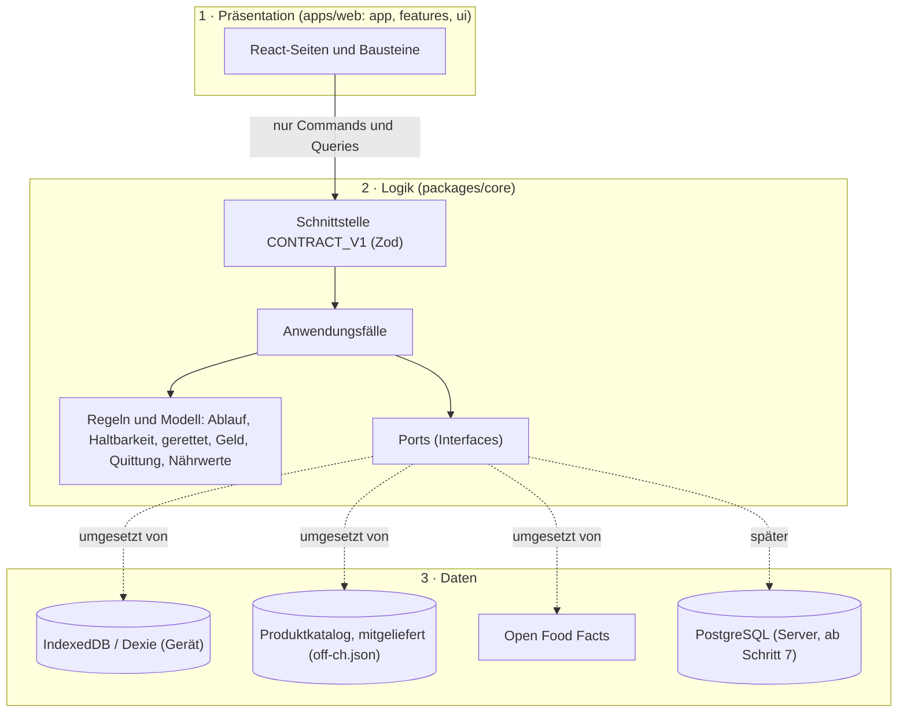

# Rettich – Architektur: heute bauen, morgen skalieren

> Stand: 8. November 2026 (Version 0.10.0 und folgende PRs). Auftrag von Alban: «Denke gross, erweiterbar, wartbar, state of the art, skalierbar bis Unicorn.»
> Entscheide im Detail: [`adr/`](./adr/). Stand: [`plan.md`](./plan.md).

## 0. Drei Schichten ([ADR-0034](./adr/0034-three-layers.md))

- **Präsentation** kennt nur die Schnittstelle. **Logik** kennt nur Ports. **Daten** setzen die Ports um: heute Dexie im Browser, später zusätzlich PostgreSQL auf dem Server.
- Die Grenzen prüft ESLint in der CI.
- Die meisten Anwendungsfälle liegen in `packages/core/src/application`: Vorrat, Abschlüsse, Haushalt, Einkaufsliste, Auszüge und der Quittungs-Abgleich. In `apps/web/src/data` bleiben die Produktsuche und der Quittungs-Import (TD-02) sowie Löschen und Import des Haushalts (TD-03). Der Weg steht in ADR-0034.

## 1. Leitprinzipien

1. **Modularer Monolith statt Microservices.** Ein Repo, klare Module (`core`, `web`, später `api`, `mobile`), harte Grenzen über Ports und die Schnittstelle. Microservices erst, wenn ein Teil wirklich unabhängig skalieren muss (Erfahrungswert: Millionen aktive Haushalte, nicht vorher).
2. **Contract-first** (ADR-0005): Jede Aktion ist ein Command oder eine Query mit Zod-Schema. Daraus entstehen REST-API und MCP-Tools. Eine Schnittstelle, viele Oberflächen.
3. **Local-first** (ADR-0003): Die App funktioniert offline und ohne Konto. Das entlastet Server (die meisten Lesezugriffe passieren auf dem Gerät) und ist ein Datenschutz-Vorteil.
4. **Event-getrieben:** Jede Änderung erzeugt ein Domain Event. Dashboards und Auszüge hängen sich an Events, nicht an die Datenbank.
5. **Datenschutz als Produktmerkmal:** Bilder bleiben auf dem Gerät, ausser die Person willigt ausdrücklich ein. Kein Verkauf von Einzeldaten.
6. **Mehrsprachig von Anfang an** (ADR-0008): Deutsch zuerst, Französisch, Italienisch und Englisch sind im Code vorgesehen.

## 2. Frontend

| Thema | Entscheid | Warum |
| --- | --- | --- |
| Framework | **React 19 + TypeScript + Vite** (bleibt) | Grösstes Ökosystem, beste Talentbasis, gleiche Sprache wie Backend und Kern. Angular wäre ebenfalls robust, bringt hier aber keinen Vorteil und würde den bestehenden Stand verwerfen. |
| App-Form | **PWA** | Eine Codebasis für Web, iOS und Android. |
| Daten im Gerät | IndexedDB (Dexie) | Offline, schnell, gross genug für jahrelange Vorräte. |
| Design | Eigenes Design-System (Tokens, Bausteine, Styleguide) | Einheitlich, zugänglich, schnell erweiterbar. |

Backend und Konten sind entschieden, aber nicht gebaut: [ADR-0009](./adr/0009-backend-stack.md), [ADR-0010](./adr/0010-auth.md).
